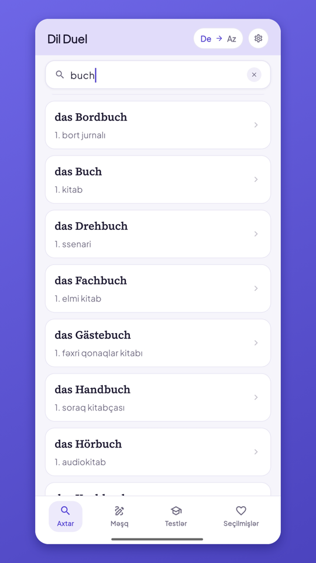
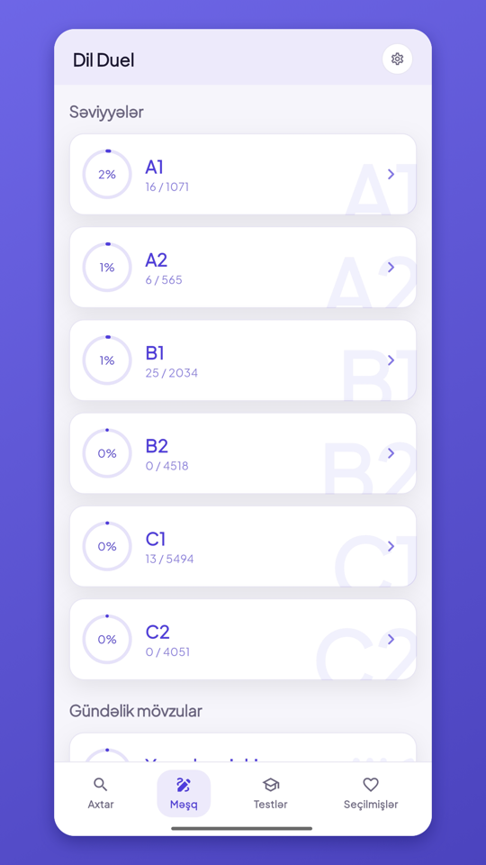
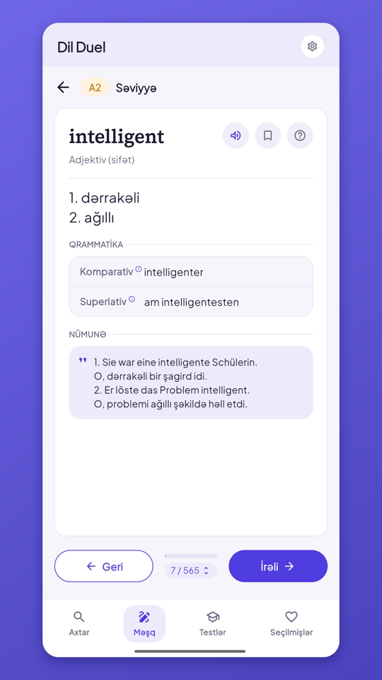
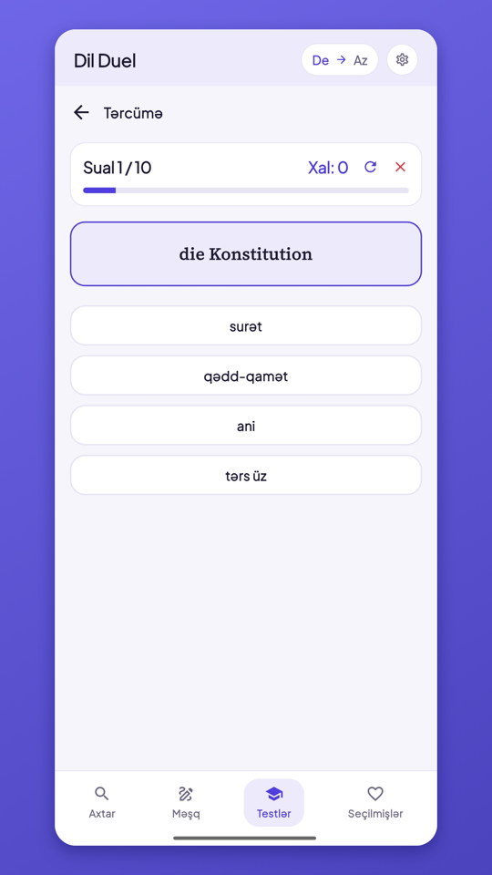
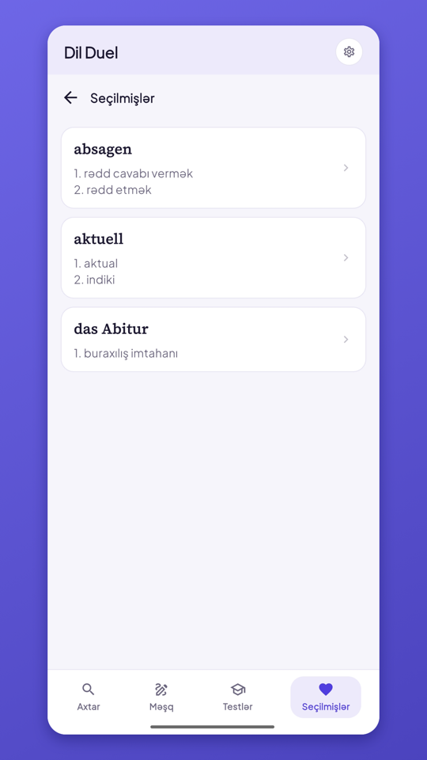

# Dil Duel

A German–Azerbaijani dictionary for learners. Look up words in both directions, practise vocabulary by level, and test yourself with quizzes. The whole dictionary is built into the app, so it works without an internet connection.

  
  
  
  
  

## What it does

- **Search** — find a word instantly, German → Azerbaijani or Azerbaijani → German. You can also search by voice.
- **Word cards** — meanings, grammar details (such as articles and comparison forms) and example sentences. Tap the speaker to hear the pronunciation.
- **Practice by level** — German words grouped from A1 to C2, plus everyday topics, with your progress shown on every level.
- **Quizzes** — multiple-choice translation and listening tests, with your results saved so you can see how you improve.
- **Bookmarks** — save the words you want to come back to.
- **Your account (optional)** — sign in with Google, Apple or email to keep your bookmarks and progress on all your devices. The app works fully without an account.
- **Light and dark mode**, and an interface in Azerbaijani or German.

## Dictionary data

The dictionary is based on *Alman – Azərbaycanca lüğət* (A1–B2) by Ramil Səfiyev. The credit is also shown in the app under Settings → About app.

## Links

[Website and privacy policy](https://elvinmammadov.github.io/DilDuel/)
